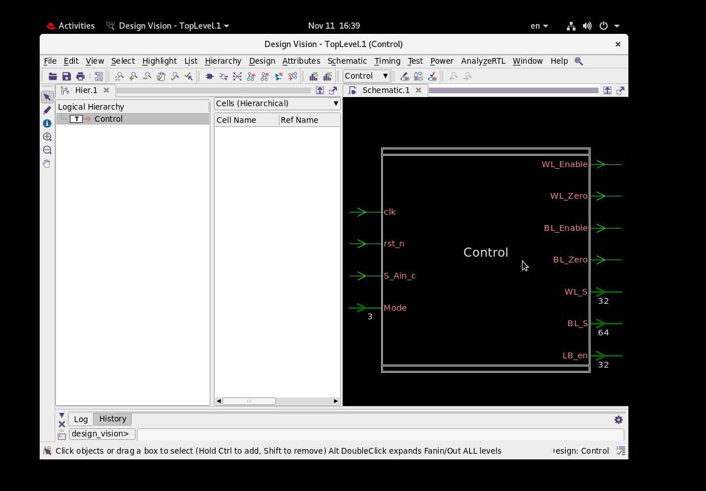
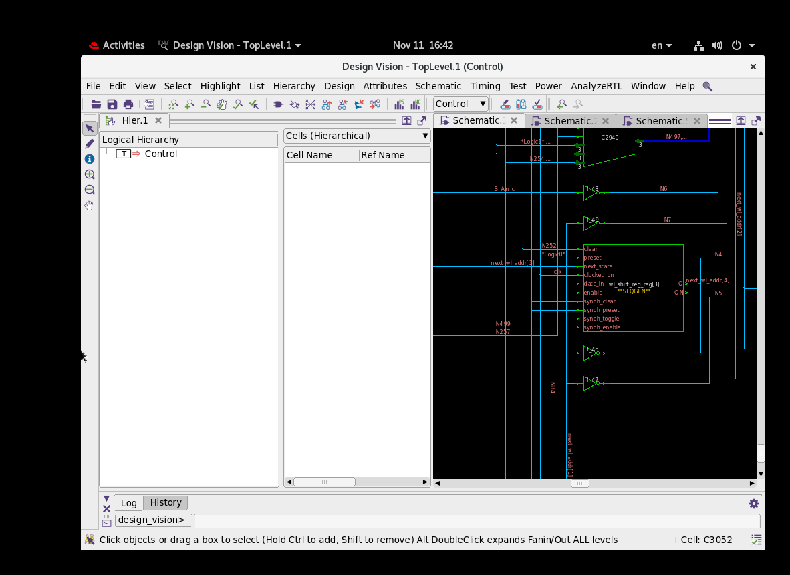
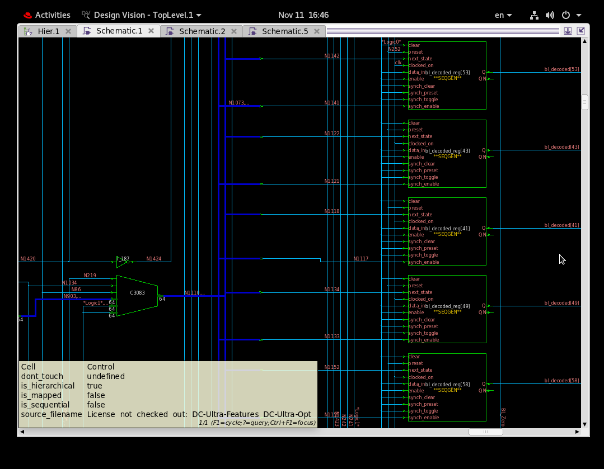
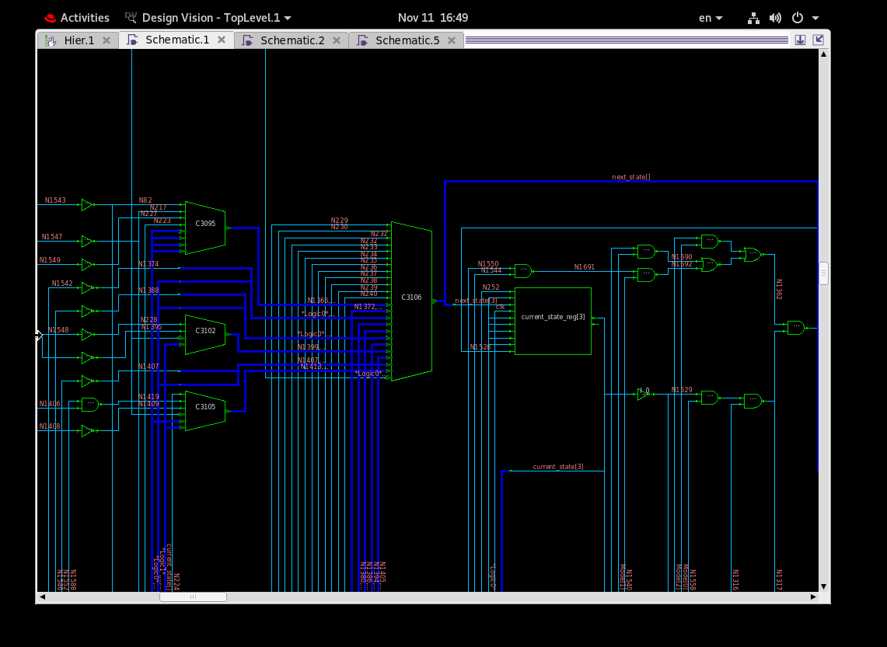
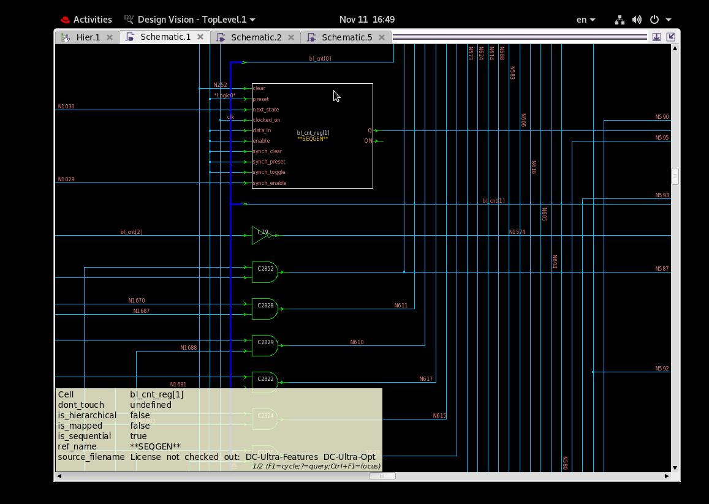

# SNN Chip Control Block - Synthesis and Gate-Level Verification

This repo takes the **control block** of an SNN (spiking neural network) memory-array chip from
SystemVerilog RTL to a verified gate-level netlist in a **Tower 0.18 um** technology.

- **RTL** (`Control.sv`) was given to us as-is (author credits are in its header comment). We did
  **not** modify it.
- **Our work:** synthesis scripts, constraints, self-checking testbenches, gate-level simulation, and
  moving the design to a second standard-cell library.

---

## Current status (2026-11-11)

| Step | Old library `tsl18fs120` (branch `main`) | **New library `tsl18fs190svt` / TS18PM (branch `ts18pm`)** |
|---|---|---|
| Synthesis @ 10 ns clock (100 MHz) | Met, slack **+6.09 ns** | Met, slack **+4.60 ns** |
| Cells (flip-flops / combinational) | 819 (154 / 665) | 731 (154 / 577) |
| Cell area* | 1781 | 12700 |
| Power (typical) | 1.14 mW | 0.98 mW |
| Design-rule violations | - | **0** |
| RTL simulation | 282 / 282 pass | 282 / 282 pass |
| Gate-level simulation, zero delay | 282 / 282 pass | 282 / 282 pass |
| Gate-level simulation, real cell delays | - (library has zero-delay models only) | 282 / 282 pass, no timing violations |

\* The two libraries report area in different units, so the area numbers are not comparable.

**Conclusion:** the netlist is functionally identical to the RTL in both libraries and meets timing
with a large margin. The TS18PM version is the current one.

Not done yet: place & route (Innovus), multi-corner timing (only the typical corner was used).

---

## The design in one paragraph

Module `Control` is an 11-state FSM clocked by `clk` with async reset `rst_n`. `Mode[2:0]` selects
the operation and a code is shifted in serially, MSB first, on `S_Ain_c`:

| Mode | Operation | Code | Outputs |
|---|---|---|---|
| `000` | Idle | - | everything off, masks cleared |
| `001` | Program | 5 bits -> word line 0..31 | `WL_S`: all 1 (all lines connected), each received code turns **its** bit off (cumulative); all bit lines held at 0 |
| `010` | Erase | 6 bits -> bit line 0..63 | `BL_S`: all 1, each received code turns its bit off (cumulative); all word lines held at 0 |
| `011` | Inference | - | everything off |
| `100` | Loop-back | 5 bits -> N | `LB_en` = thermometer code (bits 0..N set) |
| `101`-`111` | undefined | - | behave like idle |

**Mask meaning (confirmed by the supervisor):** `WL_S`/`BL_S` bits are 1 = line connected, and the
line whose number is received is turned off (0). Example: erase code 40 -> `BL_S = fffffeffffffffff`.
Before the first complete code `WL_Enable`/`BL_Enable` = 0, so the outputs are forced to all 0 (nothing
is driven by a partial code); once a full code is in, the enable goes to 1 and the stored mask
(all 1 except the received bit) appears on the output.

`WL_Enable`/`BL_Enable` say a side of the array is driven; `WL_Zero`/`BL_Zero` say that side is held
at 0. In program and erase **both** sides are driven (one pulses, the other is grounded), so
`WL_Enable` and `BL_Enable` are always equal in this RTL - which is why the netlist contains
`assign BL_Enable = WL_Enable;`. This is expected, not a bug.

---

## Schematics (Design Vision, elaborated RTL view)

Generic register-level view (`analyze` + `elaborate`, before mapping to Tower cells) - this is the
readable "functional schematic"; the mapped netlist has 731 cells and is too dense to read.

| Picture | What it shows |
|---|---|
|  | **Top-level symbol**: inputs `clk`, `rst_n`, `S_Ain_c`, `Mode[2:0]`; outputs `WL_Enable/Zero`, `BL_Enable/Zero`, `WL_S[31:0]`, `BL_S[63:0]`, `LB_en[31:0]` |
|  | **Word-line shift register** (`wl_shift_reg`): `S_Ain_c` enters bit by bit, each flip-flop feeds the next (`next_wl_addr`) |
|  | **Bit-line select registers** (`bl_decoded_reg[..]`): one flip-flop per bit line, loaded through the 64-bit mux on the left; they drive `BL_S` |
|  | **FSM**: next-state mux (`C3106`) choosing between transitions, `current_state_reg`, and the state-decode gates |
|  | **Bit counter** (`bl_cnt_reg`) that counts the 6 erase-code bits and tells the FSM when a code is complete |

---

## The tests

`tb_Control.sv` is **self-checking**: after every step it compares all 7 outputs with the expected
value and prints `FAIL ...` with got/want on any mismatch. Inputs change on the falling clock edge and
outputs are checked after the rising edge, so the same testbench runs on the RTL and on the netlist.

| Section | What it checks | Checks |
|---|---|---|
| Reset | all outputs off during and after reset | 2 |
| Program | all 32 codes in a row; each one is applied and held, turned-off bits accumulate | 65 |
| Program after idle | going through idle clears the masks | 2 |
| Erase | all 64 codes in a row, applied and held, masks accumulate | 130 |
| Loop-back | all 32 codes give the right thermometer; a lower code shrinks it | 67 |
| Inference | outputs stay off for 8 clocks | 8 |
| Abort | half-sent code produces nothing; next code decodes fresh; mode change -> idle | 3 |
| Undefined modes | modes 101/110/111 act like idle | 3 |
| Async reset mid-erase | reset in the middle of an operation turns everything off | 2 |
| **Total** | | **282** |

`tb_Control_gl.sv` is the same testbench with one change: after the asynchronous reset it waits
**3 ns** instead of 1 ns before checking, because the TS18PM cell models have real propagation delays
(see problem 2 below).

`tb_demo.sv` is not a pass/fail test: it prints inputs and outputs clock by clock for a few example
codes, to show how a code turns into `WL_S` / `BL_S` / `LB_en`.

---

## Files

| File | What it is |
|---|---|
| `Control.sv` | the RTL (identical copy of `Control_block_Fixed.txt`, the file we received) |
| `.synopsys_dc.setup` | Design Compiler library setup - **on this branch points at TS18PM `tsl18fs190svt_tt_1p8v_25c.db`** |
| `control_syn.tcl` | synthesis script: 10 ns clock, 0.05 pF load on outputs, `compile -exact_map`, writes netlist + reports |
| `Control_syn.v` | synthesized gate-level netlist |
| `control.sdc` | constraints written by DC (for place & route) |
| `reports/` | `timing.rpt`, `area.rpt`, `power.rpt`, `drc_violators.rpt` (current library) |
| `tb_Control.sv` | 282-check self-checking testbench |
| `tb_Control_gl.sv` | same, 3 ns reset check, for real-delay gate-level simulation |
| `tb_demo.sv` | clock-by-clock demo |
| `results/test_output.txt` | RTL simulation: 282/282 |
| `results/gate_level_output_ts18pm_zero.txt` | TS18PM netlist, zero delay: 282/282 |
| `results/gate_level_output_ts18pm_delay.txt` | TS18PM netlist, real delays: 282/282 |
| `results/gate_level_ts18pm_BUG_reset_1ns.txt` | the failing run that exposed bug 3 (kept as evidence) |
| `results/gate_level_output.txt`, `results/gate_level_demo.txt`, `results/demo_output.txt` | old-library (fs120) runs |
| `docs/ts18pm_kit_scan.txt` | listing of the TS18PM_1 kit used to choose the library files |
| `pics/` | Design Vision schematic screenshots (see Schematics section) |
| `CLAUDE.md` | working notes: rules, lab recipe, detailed status and bug log |

---

## Problems found and how they were fixed

| # | Problem | Cause | Fix |
|---|---|---|---|
| 1 | Gate-level sim would not elaborate (`CUMSTS: Timescale directive missing`) | TS18PM cell models declare `1ns/1ps`, the netlist declares none | run `xrun` with `-timescale 1ns/1ps` |
| 2 | Real-delay gate-level sim failed 1 of 282 checks ("async reset during erase") | the testbench checked only 1 ns after reset; real cell delays are longer | `tb_Control_gl.sv` waits 3 ns -> 282/282 (commits `6fc46c9` BUG, `346cffc` FIX) |
| 3 | 129 design-rule violations (`min_capacitance` on every output) | no output load was specified, so outputs looked like 0 pF | `set_load 0.05 [all_outputs]` -> 0 violations (commit `06ea472`) |

---

## How to reproduce (lab machine)

```
dc_shell -x "source control_syn.tcl; exit" | tee syn.log

set K=/tools/kits/tower/TS18PM_1/tsl18fs190svt_Rev_2019.09/lib/verilog
xrun -sv -timescale 1ns/1ps Control_syn.v tb_Control_gl.sv -v $K/tsl18fs190svt.v -v $K/tsl18fs190svt_udp.v
xrun -sv -timescale 1ns/1ps -delay_mode zero Control_syn.v tb_Control.sv -v $K/tsl18fs190svt.v -v $K/tsl18fs190svt_udp.v
```
RTL only (any simulator, e.g. Icarus): `iverilog -g2012 Control.sv tb_Control.sv && vvp a.out`

---

## Open questions for the supervisor

1. `WL_Enable` and `BL_Enable` are always equal in the RTL - should they stay two separate pins?
2. (answered) mask meaning: 1 = connected, received code turns its bit off.
3. Is the 1-clock gap between consecutive codes acceptable?
4. Is 0.05 pF a reasonable estimate of the output load (word-line / bit-line drivers)?
5. Merge `ts18pm` into `main`, and start place & route with the new library?
