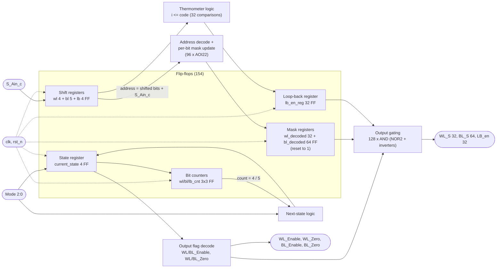

# How the synthesized circuit implements `Control.sv`

Synthesis (Design Compiler) reads the SystemVerilog, recognises what each construct means in hardware,
and builds it from the standard cells of the Tower TS18PM library (`tsl18fs190svt`). This page walks
through the code part by part and shows **which hardware it became**, using real cell names from
`Control_syn.v` (branch `ts18pm`).

Result: **731 cells = 154 flip-flops + 577 combinational gates**.

---

## 1. Block diagram of the generated circuit



---

## 2. Code -> hardware, part by part

### 2.1 `always_ff @(posedge clk or negedge rst_n)` -> 154 flip-flops

Every variable assigned inside the `always_ff` becomes a bank of D flip-flops clocked by `clk`.
The `negedge rst_n` makes the reset **asynchronous**, so DC picked flip-flops with an asynchronous
reset/set pin. Which kind depends on the reset value in the code:

| Reset value in the code | Cell chosen | Count | Registers |
|---|---|---|---|
| `<= 0` | `DFFRQ_X2` (async **reset** to 0, pin `RN`) | 58 | state, shift registers, counters, `lb_en_reg` |
| `<= 32'hFFFF_FFFF`, `64'hFFFF...` | `DFFSQ_X2` (async **set** to 1, pin `SN`) | 96 | `wl_decoded` (32) + `bl_decoded` (64) |

Example from the netlist:
```
DFFSQ_X2_18_SVT \wl_decoded_reg[5] ( .D(n389), .CK(clk), .SN(rst_n), .Q(wl_decoded[5]) );
DFFRQ_X2_18_SVT \lb_en_reg_reg[3]  ( .D(n421), .CK(clk), .RN(rst_n), .Q(lb_en_reg[3]) );
```

| Register in the code | Bits in code | Flip-flops in netlist |
|---|---|---|
| `current_state` | 4 | 4 |
| `wl_shift_reg` / `bl_shift_reg` / `LB_SR` | 5 / 6 / 5 | **4 / 5 / 4** |
| `wl_cnt` / `bl_cnt` / `lb_cnt` | 3 / 3 / 3 | 3 / 3 / 3 |
| `wl_decoded` / `bl_decoded` / `lb_en_reg` | 32 / 64 / 32 | 32 / 64 / 32 |
| **Total** | **157** | **154** |

**Why 3 fewer?** The code builds the address as `{wl_shift_reg[3:0], S_Ain_c}`: the top bit of each
shift register (`wl_shift_reg[4]`, `bl_shift_reg[5]`, `LB_SR[4]`) is written but **never read**.
DC sees it has no effect on any output and removes it. The behaviour is unchanged.

### 2.2 Shift registers: serial code in

```systemverilog
assign next_wl_addr = {wl_shift_reg[3:0], S_Ain_c};
wl_shift_reg <= next_wl_addr;
```
A chain of flip-flops: each clock, every bit moves one place and `S_Ain_c` enters at the bottom
(picture `pics/02_wl_shift_register.png`). On the **last** bit the address is taken directly from
`{shift register, S_Ain_c}` - the final bit does not need to be stored first, so the line is decoded on
the same clock edge.

### 2.3 Counters: "is the code complete?"

`wl_cnt` / `bl_cnt` / `lb_cnt` are 3-bit counters (3 flip-flops + an incrementer each). The compare
`wl_cnt == 3'd4` (5th bit) and `bl_cnt == 3'd5` (6th bit) become small AND/NOR gates that feed the
next-state logic (picture `pics/05_bl_bit_counter.png`).

### 2.4 FSM: `case (current_state)` -> state register + next-state logic

- `typedef enum logic [3:0]` -> **4 flip-flops** (`current_state_reg[0..3]`) with the binary codes from
  the code (IDLE = 0000, SHIFT_PROG = 0001, ...).
- The whole `always_comb case` (all `if (Mode != ...)` / `else if (cnt == ...)` lines) becomes one block of
  combinational gates whose output is `next_state`, fed back into the 4 flip-flops
  (picture `pics/04_fsm_state_register.png`).
- `Mode != 3'b001 -> IDLE` is just a 3-bit comparison of `Mode`; it is what makes any Mode change send the
  machine back to IDLE.

### 2.5 Decoder + cumulative mask: `wl_decoded[next_wl_addr] <= 1'b0`

This one line means "5-to-32 decoder, and clear the selected bit". DC does **not** build a separate
decoder followed by a register; it merges both into the next-value logic of each mask bit. Each of the
96 mask bits gets **one `AOI22` gate** (And-Or-Invert) in front of its flip-flop - there are exactly
**96 AOI22 cells** in the netlist:

```
AOI22_X0_18_SVT U769 ( .A0(n668), .A1(n636), .B0(n672), .B1(n479), .Q(n389) );  -> D of wl_decoded[5]
NOR2P3_X1_18_SVT U771 ( .A(n557), .B(next_wl_addr[1]), .Q(n636) );              -> part of "address == 5"
```
In words, the next value of `wl_decoded[5]` is:
- keep the old value (`n672` = inverted `wl_decoded[5]`, with `n479` = "hold"), **or**
- clear it when the incoming address equals 5 on the last bit (`n636`, `n668` = decoded address terms), **or**
- set it back to 1 in IDLE / INFERENCE (the `if (current_state == IDLE ...)` block).

The address-match terms (`address == k`) are shared between bits, which is why there is no visible
"decoder" box in the gate-level netlist - it is spread over the NOR/NAND gates that feed the AOI22s.

### 2.6 Loop-back thermometer: `if (i <= next_lb_code)` inside a `for` loop

The `for (int i = 0; i < 32; i++)` loop is **unrolled** into 32 copies of the hardware. In the
elaborated view each copy is a `<=` comparator (`lte_151_I0` ... `lte_151_I31`,
`pics/06_loopback_comparators.png`). Because `i` is a constant in each copy, the compiler simplifies
every comparator to a few gates (for example `0 <= code` is always true). The results go into the 32
`lb_en_reg` flip-flops.

### 2.7 Output flags: `always_comb` with `WL_Enable = ...`

Decoding of the state register into four signals:
```
CLKNAND2_X2_18_SVT U1142 ( .A(n504), .B(n764), .Q(WL_Enable) );
NOR4_X0_18_SVT     U1144 ( .A(n538), .B(n551), .C(n534), .D(current_state[3]), .Q(WL_Zero) );
CLKINV_X1_18_SVT   U606  ( .A(n504), .Q(BL_Zero) );
```
In the code `WL_Enable` and `BL_Enable` get the same value in every state, so DC builds the logic
once and connects both pins to it (`assign BL_Enable = WL_Enable;` in the netlist).

### 2.8 Output gating: `assign WL_S = WL_Enable ? (WL_Zero ? 0 : wl_decoded) : 0`

The code comment says "Tri-State Buffers", but the code drives **0** (not `Z`), so the hardware is
plain **AND gating**: `WL_S[i] = (WL_Enable AND NOT WL_Zero) AND wl_decoded[i]`.

```
CLKINV_X1_18_SVT  U1143 ( .A(WL_Zero), .Q(n764) );                    NOT WL_Zero
CLKNAND2_X2_18_SVT U946 ( .A(WL_Enable), .B(n764), .Q(n763) );        "show mask" (active low)
BUF_X2_18_SVT     U584  ( .A(n763), .Q(n477) );                       buffer: drives 32 gates
CLKINV_X1_18_SVT  U945  ( .A(wl_decoded[0]), .Q(n677) );
NOR2P3_X1_18_SVT  U944  ( .A(n477), .B(n677), .Q(WL_S[0]) );          = AND(show, wl_decoded[0])
```
The same pattern repeats for all 32 `WL_S`, 64 `BL_S` and 32 `LB_en` bits = **128 output gates**
(most of the 141 `NOR2P3` cells), plus inverters and `BUF_X2` buffers because one control signal has to
drive 32-64 gates.

---

## 3. Where the 731 cells go

| Function (code part) | Main cells | Approx. count |
|---|---|---|
| Registers (`always_ff`) | `DFFSQ_X2` 96, `DFFRQ_X2` 58 | 154 |
| Mask update incl. decoder (`wl/bl_decoded[addr] <= 0`) | `AOI22` + shared NOR/NAND decode | ~96 + decode |
| Output gating (`assign WL_S/BL_S/LB_en`) | `NOR2P3` + `CLKINV` + `BUF_X2` | ~128 + inverters |
| Inverters (mostly inverted flip-flop outputs feeding the gates) | `CLKINV_X1` | 161 |
| FSM next-state, counters, thermometer, flags | `OAI221`, `OAI12`, `NOR3`, `MUXI2D`, ... | rest |

Full list: `grep -oE "^\s+[A-Z0-9_]+_18_SVT" Control_syn.v | sort | uniq -c`.

---

## 4. How we know the circuit really implements the code

1. **Same testbench on both:** the 282-check `tb_Control.sv` passes on the RTL and on `Control_syn.v`
   with the real Tower cell models, both with zero delay and with real delays (`tb_Control_gl.sv`).
2. **Timing:** the slowest path (`current_state_reg[2]` -> `BL_S[26]`, 5.4 ns) is shorter than the 10 ns
   clock, slack +4.60 ns, so every flip-flop gets a settled value at every edge.
3. **Design rules:** 0 violations (transition / capacitance / fanout).

---

## 5. Showing it live in Design Vision

After `source control_syn.tcl` (mapped netlist loaded):
- **Schematic of one output path:** select the port `WL_S[0]` -> right-click -> *Add Fanin* (repeat to
  walk back through `NOR2P3 U944` -> `BUF U584` -> `NAND U946` -> the state flip-flops).
- **Critical path:** `Timing -> Report Timing Path`, then *Path Schematic* - draws exactly the gates on the
  slowest path.
- **Find a cell:** `select -name U944` or `change_selection [get_cells U944]`, then
  *Schematic -> Add Fanin/Fanout*.
- **Readable functional view (before mapping):** `remove_design -all; analyze -format sverilog Control.sv;
  elaborate Control` -> *Schematic -> New Schematic View* (this is where `pics/01-06` come from).
